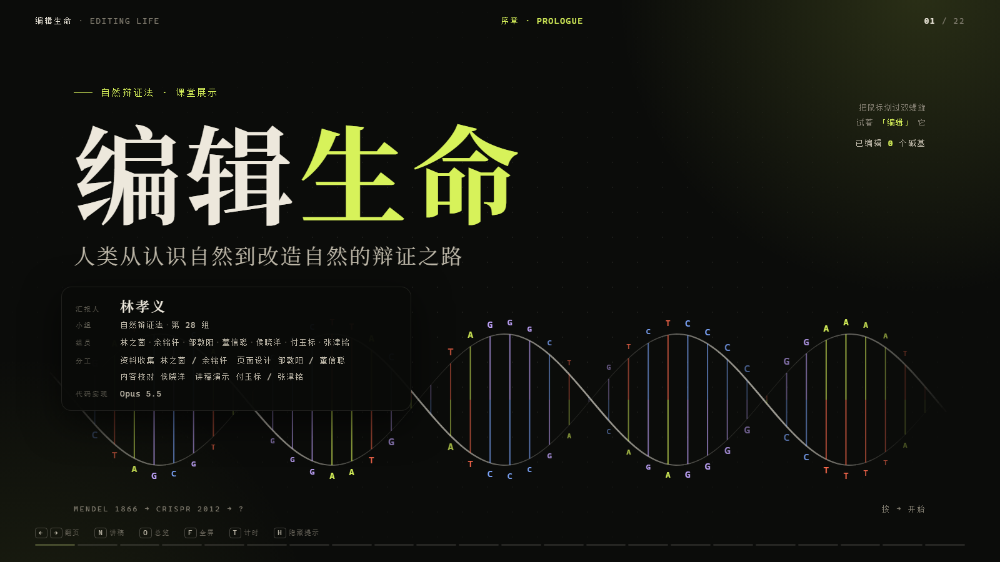
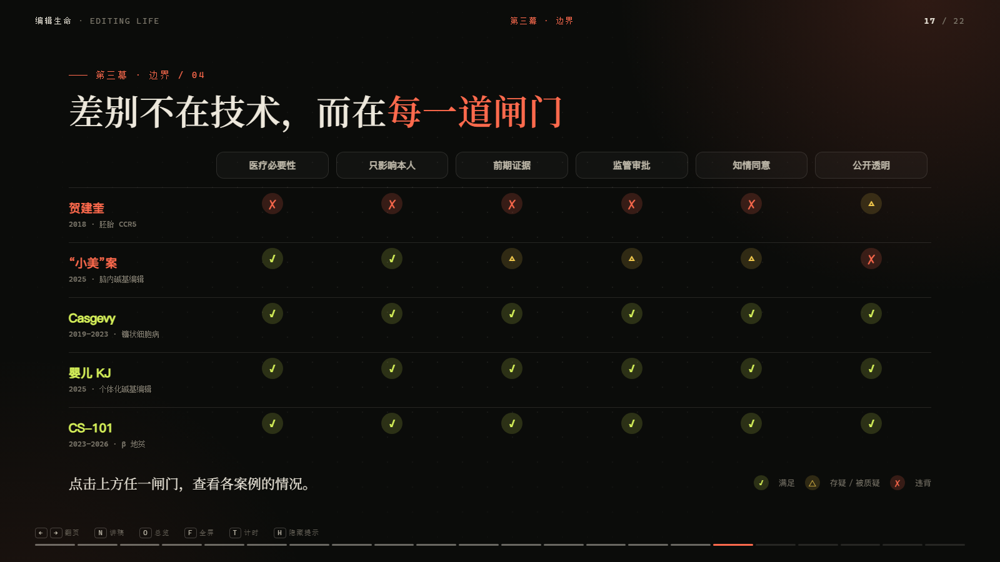
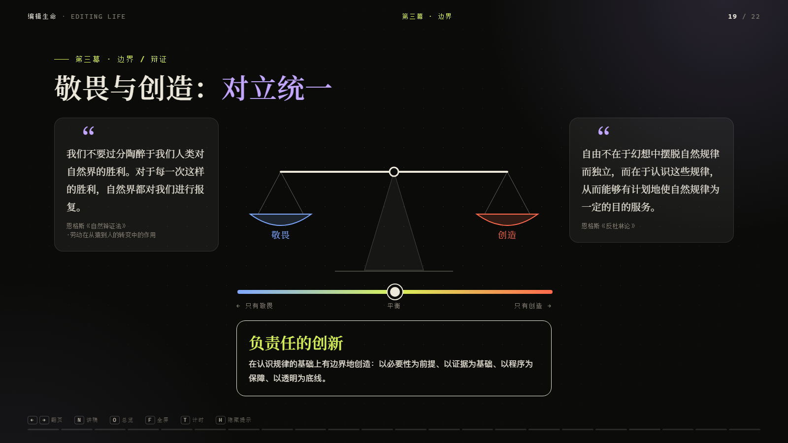

# 编辑生命 · EDITING LIFE

**人类从认识自然到改造自然的辩证之路** —— 自然辩证法课堂展示（第 28 组）

一个 **22 页的单文件互动网页**。没有框架、没有构建、没有依赖：`index.html` 双击就能放映，
手机扫码就能实时投票，按 `N` 键屏幕上会浮出当页讲稿。



---

## 在线预览

> `https://<你的用户名>.github.io/edit-life/`

（把上面这行换成你自己的地址；部署方法见下文「三、发布到 GitHub Pages」。）

---

## 一、这个网页在讲什么

全片按三幕推进，对应基因技术一百五十年的辩证逻辑：

| 幕 | 命题 | 关键页 |
|---|---|---|
| **序章** | 人类开始"改写"生命之书 | 可交互的 DNA 双螺旋 |
| **第一幕 · 认识** | 从孟德尔的统计到 CRISPR 的分子剪刀 | 摩尔根果蝇杂交模拟、CRISPR 五步动画、专利 vs 诺奖 |
| **第二幕 · 传播** | 同一项技术，为什么会被讲成两个故事 | 转基因四个误解、育种光谱、黄金大米双轨道、一句话的"传话游戏" |
| **第三幕 · 边界** | 差别不在技术，而在每一道闸门 | 贺建奎 / "小美"案 / 三个被治愈的人 / 六道闸门对比矩阵 / 边界地图 |
| **终章** | 敬畏与创造的对立统一 | 可拖动的天平、结尾投票与开场结果对照、54 条参考文献 |

## 二、二十二次翻页里，几乎每页都能动手

不是"放 PPT"，是让听众上手：

- **封面**：鼠标划过双螺旋，碱基会被"改写"，右下角实时记账。
- **摩尔根页**：自己点"杂交"，看 F1、F2 的性状分离，再和 1910 年的真实计数对照。
- **黄金大米页**：拖动"科学轨道 / 社会轨道"，看同一种米如何被两套逻辑评价。
- **对比矩阵页**：点击任意一道闸门，逐案展开"为什么通过 / 为什么被否"。
- **辩证页**：拖动"敬畏 ↔ 创造"滑块，天平倾斜，结论随之改变。
- **两次投票**：第 2 页与第 20 页各一次，大屏环形图约每 2 秒刷新。

<table>
<tr>
<td width="50%"></td>
<td width="50%"></td>
</tr>
</table>

## 三、本地打开

直接双击 `index.html` 即可。未配置云端时自动进入**本地演示模式**：

- 点图表里的选项、或按"＋模拟 8 票"，即可看到实时效果；
- 另开一个标签页访问 `index.html?vote=q1`，可模拟手机投票。

## 四、部署到线上（三步，约 10 分钟）

### 第 1 步：建云端投票库（Supabase，免费）
1. 打开 <https://supabase.com> 注册，点 **New project**（区域建议 Singapore / Tokyo，国内访问更快）。
2. 项目建好后，左侧 **SQL Editor → New query**，把 `supabase_setup.sql` 全部粘贴进去 → **Run**。
3. 左侧 **Project Settings → API**，复制 **Project URL** 与 **anon public key**（或新版 `sb_publishable_…`）。

### 第 2 步：把钥匙填进网页
用记事本 / VS Code 打开 `index.html`，在最上方找到 `window.POLL_CONFIG`：

```js
window.POLL_CONFIG = {
  SUPABASE_URL: "https://abcdefgh.supabase.co",
  SUPABASE_KEY: "你的 anon / publishable key",
  SESSION: "class-2026",        // 换一个值即可清零重来（旧数据仍留在库里）
  POLL_INTERVAL: 2000,          // 大屏刷新间隔（毫秒）
  VOTE_BASE_URL: "",            // 一般留空；二维码默认指向当前网址
  PRESENTER: "林孝义"           // 封面"汇报人"处显示的名字
};
```

> anon / publishable key 本来就是设计给前端公开使用的；数据库已用 RLS 限制为"只能投票、改票、读取"，不能删除。

### 第 3 步：发布到 GitHub Pages
```bash
git remote add origin https://github.com/<你的用户名>/edit-life.git   # 换成你的仓库地址
git push -u origin main
```
然后仓库 **Settings → Pages** → Source 选 **Deploy from a branch** → Branch 选 `main` / `(root)` → **Save**。
约 1 分钟后网址生效：`https://<你的用户名>.github.io/edit-life/`。

打开网址后，投票页左下角徽标显示 **"云端实时 · 每 2 秒同步"** 即表示成功。

> 不想用命令行？也可以直接在 GitHub 网页上 **Add file → Upload files** 上传 `index.html`，再开 Pages。

## 五、上台演示

| 按键 | 功能 |
|---|---|
| `→` / `空格` / `PageDown` | 下一页（翻页笔可直接用） |
| `←` / `PageUp` | 上一页 |
| `N` | 打开 / 关闭**讲稿抽屉**（只在你自己的屏幕上） |
| `O` | 总览，点击跳转任意页 |
| `F` | 全屏 |
| `T` | 开始 / 停止计时（超过 10 分钟变红） |
| `H` | 隐藏底部按键提示 |

**投票流程**：第 2 页、第 20 页显示二维码 → 同学扫码 → 手机点选 → 大屏图表约 2 秒内刷新。
每台手机每题一票，可随时改票。

## 六、讲稿

- [`讲稿.md`](讲稿.md)：约 **9 分 30 秒** 的精简版（含两次投票等待），后附可能被问到的问题。
- 网页内按 `N` 键：只在你的屏幕上弹出当页讲稿。
- `index.html?script=1`：可打印的讲稿版；`index.html?script=full`：约 12 分钟的详细版。

## 七、目录结构

```
.
├── index.html           # 全部内容：22 页演示 + 投票页 + 讲稿页（单文件，约 180 KB）
├── supabase_setup.sql   # 投票库建表 + RLS 策略
├── 讲稿.md               # 汇报讲稿（含答辩备用问答）
├── preview/             # README 用的页面截图
├── LICENSE
└── README.md
```

## 八、常见问题

- **二维码不显示？** 二维码库从多个国内 CDN 依次加载，全部失败时会退化成直接显示网址，照着手输也能投。
- **徽标显示"连接失败"？** 检查 URL / KEY 是否填对、`supabase_setup.sql` 是否运行成功；校园网偶尔会拦截 `supabase.co`，可换手机热点再试。
- **想清空票数重来？** 把 `SESSION` 改成别的值（如 `class-2026-b`）再重新上传即可；旧数据仍留在数据库里。
- **双击打开能演示吗？** 能，进入本地演示模式；但手机必须访问 GitHub Pages 的网址才能投票。
- **投错了能改吗？** 能，同一台手机同一道题可以重新点选，只保留最后一票。

## 九、技术说明

- **零依赖**：没有 npm、没有打包、没有 CDN 必需的资源；断网也能放映（二维码库多源加载，全失败时退化成显示网址）。
- **排版**：1600×900 固定舞台，等比缩放适配任意投屏比例，不会错位。
- **图形**：天平、螺旋、矩阵、时间线全部是手写 SVG / Canvas，随窗口缩放不失真。
- **投票**：Supabase REST 轮询（大屏）＋ localStorage + BroadcastChannel（本地演示、同浏览器多标签同步）。
- **无追踪**：不加载任何统计脚本，投票是匿名的（只记设备本地随机 ID，用于"每题一票、可改票"）。

## 十、组员与分工

| 角色 | 成员 |
|---|---|
| 汇报人 | 林孝义 |
| 组员 | 林之茵、余铭轩、邹敦阳、董信聪、侯晓洋、付玉标、张津铭 |
| 资料收集 | 林之茵 / 余铭轩 |
| 页面设计 | 邹敦阳 / 董信聪 |
| 内容校对 | 侯晓洋 |
| 讲稿演示 | 付玉标 / 张津铭 |
| 代码实现 | Opus 5.5 |

## 十一、许可与致谢

代码以 **MIT License** 发布，欢迎取用、修改、再分发（详见 [`LICENSE`](LICENSE)）。

网页内的文字、数据与引文来自文中标注的公开文献与新闻报道（共 54 条参考文献，见第 22 页），
引用请以原始出处为准。

## 十二、两点内容说明

1. **转基因的表述**：严格说，"转基因不产生新基因"并不完全准确——诱变育种会产生新的突变，
   转基因可以把基因跨物种转移。页面采用的是更稳妥的说法：这些技术**都在已有遗传信息上改变作物的遗传组成，
   越新的技术越精确**；并附 2018 年欧盟法院裁定（随机诱变豁免监管、更精确的基因编辑反而从严）作为佐证。
2. **"小美"案仍在调查中**：资料来自《科学》杂志与 Retraction Watch 2026 年 7 月的联合报道。
   页面与讲稿均使用"据报道""专家认为"的措辞。**汇报前建议再搜一次最新进展。**
